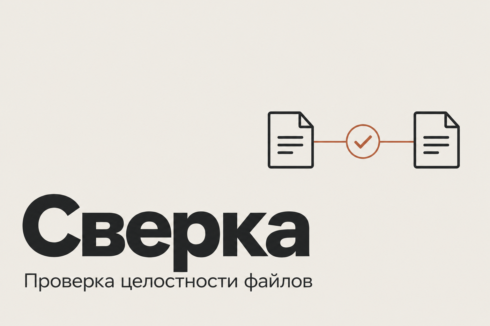

# Сверка



CLI для проверки файловых архивов, выгрузок и восстановленных копий. Сохраняет каталог SHA-256, сравнивает два состояния и заново читает файлы для проверки целостности. Помогает найти пропажу, изменение содержимого или перемещение, не полагаясь только на имя и дату файла.

**Версия 0.1.0-rc.1 · Rust · snapshot / diff / verify.** Исходные файлы инструмент не изменяет, не перемещает и не удаляет.

## Три операции

| Команда | Задача | Результат |
|---|---|---|
| `snapshot` | Зафиксировать каталог | JSON-снимок с путями, размерами, временем и SHA-256 |
| `diff` | Сопоставить два снимка | Добавленные, отсутствующие, изменённые и перемещённые файлы |
| `verify` | Перечитать исходный каталог или другую копию | Сравнение реальных байтов со снимком, без checkpoint cache |

Хеширование идёт потоково, буфером 64 KiB на worker. Параллелизм ограничен `--workers` от 1 до 64, по умолчанию 4. В памяти остаются список путей и итоговый каталог, а не содержимое всех файлов.

Перемещение определяется по совпадению SHA-256 и размера только у единственной пропавшей и единственной новой записи. Если есть одинаковые копии и соответствие неоднозначно, вывод остаётся `missing` / `added`.

## Собрать и посмотреть справку

Нужны **Rust stable**, Cargo и linker для выбранной платформы. Для Windows подходят MSVC Build Tools либо GNU MinGW с соответствующим Rust toolchain. Локально проверена Windows-сборка Rust 1.99.1 GNU; сборки macOS/Linux не выполнялись.

```powershell
cargo build --release --locked
cargo run --release --locked -- --help
cargo run --release --locked -- snapshot --help
```

Фактический стек: **Rust edition 2024**, `clap`, `serde` / `serde_json`, `sha2`, `walkdir`; тесты используют `tempfile`. Версии зависимостей закреплены в [Cargo.lock](Cargo.lock). Сетевые сервисы, база данных и Python для работы не нужны.

Все примеры ниже запускаются из каталога репозитория в PowerShell.

## Воспроизвести сравнение на своих тестовых файлах

**1. Подготовьте отдельный демонстрационный каталог.** Команды создают и затем меняют только файлы внутри `demo/source`.

```powershell
New-Item -ItemType Directory -Force demo/source, demo/catalogues | Out-Null
Set-Content -LiteralPath demo/source/notes.txt -Value 'Первоначальная запись' -Encoding utf8
Set-Content -LiteralPath demo/source/route.txt -Value 'Согласование закупки' -Encoding utf8
Set-Content -LiteralPath demo/source/obsolete.txt -Value 'Временная выгрузка' -Encoding utf8
```

**2. Создайте исходный снимок и проверьте его.** Каталог для выходных файлов уже существует и расположен отдельно от источника.

```powershell
cargo run --release --locked -- snapshot demo/source --output demo/catalogues/before.json --workers 4
cargo run --release --locked -- verify demo/catalogues/before.json --json
```

Второй вызов должен завершиться с кодом 0 и `integrity_ok: true`, если файлы между командами не менялись.

**3. Внесите три разных изменения в демонстрационные файлы.** Это действия пользователя в тестовом каталоге; сама «Сверка» таких операций не выполняет.

```powershell
Set-Content -LiteralPath demo/source/notes.txt -Value 'Запись после исправления' -Encoding utf8
Rename-Item -LiteralPath demo/source/route.txt -NewName renamed-route.txt
Remove-Item -LiteralPath demo/source/obsolete.txt
```

**4. Сохраните новое состояние и сравните.**

```powershell
cargo run --release --locked -- snapshot demo/source --output demo/catalogues/after.json
cargo run --release --locked -- diff demo/catalogues/before.json demo/catalogues/after.json --json
cargo run --release --locked -- verify demo/catalogues/before.json
```

Ожидаются изменение `notes.txt`, пропажа `obsolete.txt` и перемещение `route.txt` → `renamed-route.txt`. `diff` и последняя проверка вернут **1** — обнаруженные различия, а не ошибка исполнения. Пример предназначен для отдельного тестового каталога; повторный проход начните с новыми именами или заново подготовьте его содержимое.

Для проверки восстановленной копии задайте другой корень:

```powershell
cargo run --release --locked -- verify demo/catalogues/before.json --root demo/restored-copy --json
```

`demo/restored-copy` должен существовать и содержать проверяемые файлы.

## Вывод и коды завершения

| Код | Значение |
|---|---|
| `0` | Снимок сохранён либо различий не найдено |
| `1` | `diff` / `verify` обнаружили различия |
| `2` | Ошибка аргументов, чтения, формата или записи |

Без `--json` вывод предназначен для человека: `+` добавлен, `-` отсутствует, `!` содержимое изменено / возможное повреждение, `>` перемещён. При `--json` результат пишется в stdout, прикладная ошибка — JSON в stderr. Справка и ошибки синтаксиса аргументов остаются обычным текстом clap.

Изменение SHA-256 говорит о различии байтов, а не о его причине. Инструмент не может отличить намеренное редактирование от повреждения без дополнительного контекста.

## Исключения и продолжение после прерывания

```powershell
cargo run --release --locked -- snapshot demo/source --output demo/catalogues/large.json --exclude cache --exclude exports/private --checkpoint demo/catalogues/progress.jsonl

# После прерывания — те же root, output, excludes и checkpoint:
cargo run --release --locked -- snapshot demo/source --output demo/catalogues/large.json --exclude cache --exclude exports/private --checkpoint demo/catalogues/progress.jsonl --resume

cargo run --release --locked -- verify demo/catalogues/large.json
```

`--exclude` можно повторять. Это точный относительный путь или префикс каталога, **не glob**: `cache` исключает сам каталог и потомков, но не `cache2`. Снимки, которые вы сравниваете, должны охватывать одинаковую выборку; изменение исключений тоже может дать `added` / `missing`.

Checkpoint — JSONL-журнал завершённых файлов с синхронизацией на диск. При `--resume` проверяется совместимость корня и исключений, неполная последняя строка отбрасывается. Завершённый файл переиспользуется только при совпадении размера и nanosecond mtime. Это ускорение доверяет метаданным: изменение с искусственным сохранением прежних размера и времени может остаться незамеченным. **После resume запускайте verify**, который всегда хеширует заново.

Без `--resume` корректный checkpoint начинается заново. После завершения он остаётся для диагностики. `--resume` без `--checkpoint` даёт ошибку. Несовместимые параметры, неизвестная схема, повреждённая запись журнала и изменение файла во время чтения также завершают операцию с кодом 2.

## Как сохраняется результат

```text
WalkDir без symlinks → ограниченные workers → streaming SHA-256
                   → отсортированный каталог → temp + sync_all + rename
```

Файл проверяется по размеру и mtime до и после чтения. Если обнаружена модификация или ошибка доступа, частичный финальный снимок не публикуется, прежний output сохраняется. Итоговый файл заменяется атомарно только после успешного обхода.

Схема снимка **1** содержит `schema`, `root`, `created_unix`, `excludes`, `symlinks: "skip"` и отсортированный `files`. Каждая запись имеет `size`, `modified_ns`, `sha256`. Загрузчик проверяет схему, безопасные относительные пути и lowercase SHA-256. Изменение одного mtime не считается изменением содержимого.

Родительский каталог output/checkpoint должен существовать. Существующий output должен быть валидным снимком, checkpoint — корректным журналом: произвольные файлы и symlink outputs не перезаписываются. Output и checkpoint не могут совпадать. Если они лежат внутри корня, их имена автоматически исключаются из сканирования. Не запускайте одновременно процессы с общими выходными файлами.

## Существенные ограничения

- Обход изменяемого каталога не даёт транзакционного состояния на один момент времени. Для строгого point-in-time используйте неподвижную копию или snapshot файловой системы; новые изменения проверяйте отдельным `verify`.
- Symlinks всегда пропускаются, переход по ним выключен. Специальные файлы не каталогизируются; не-UTF8 и неоднозначные переносимые пути отклоняются.
- Память для путей и каталога растёт как O(число файлов); буферы чтения — O(workers). Замеров предельного объёма каталога здесь не заявляется.
- Снимок содержит метаданные и хеши. Он не копирует содержимое, не восстанавливает файлы и не заменяет резервную копию. Сам файл снимка не подписывается.

## Проверить реализацию

```powershell
cargo fmt --check
cargo test --locked
cargo clippy --all-targets --locked -- -D warnings
cargo build --release --locked
```

Локально прошли **2 unit + 4 integration tests**, clippy и release build. Проверяются известный SHA-256, пути, snapshot/resume, исключения, move/change/missing, сохранность прежнего output, обрезанный checkpoint, защита обычных файлов, CLI help, JSON и exit codes. Тестовые данные создаются во временных каталогах.

[GitHub Actions](.github/workflows/checks.yml) повторяет проверки на Ubuntu Rust stable. Конфигурация добавлена, выполнение CI на GitHub пока не подтверждено.

- [Архитектура и checkpoint](ARCHITECTURE.md)
- [Фактические результаты проверок](VERIFICATION.md)
- [Примечания к выпуску](RELEASE_NOTES.md)
- [CLI](src/main.rs), [библиотека сканирования и сравнения](src/lib.rs), [интеграционные тесты](tests/catalogue.rs)

## Лицензия

В [Cargo.toml](Cargo.toml) указана MIT. Отдельный файл `LICENSE` пока не добавлен.
